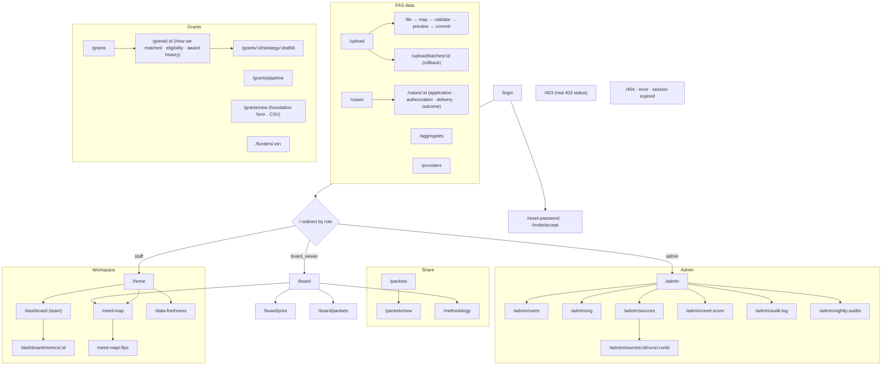
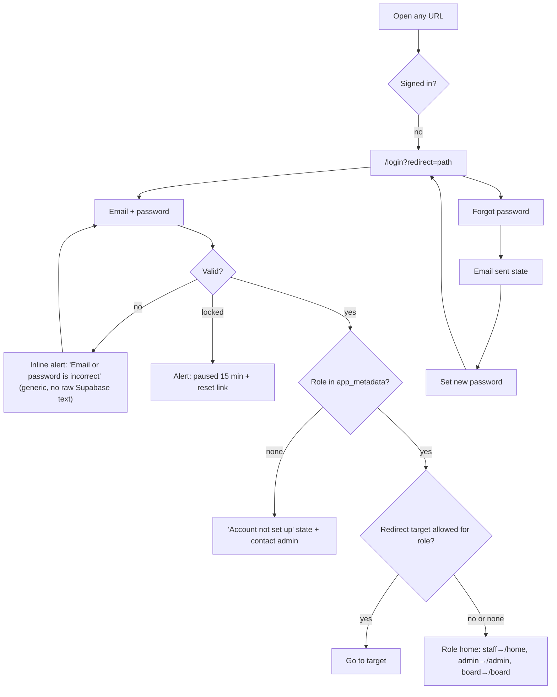
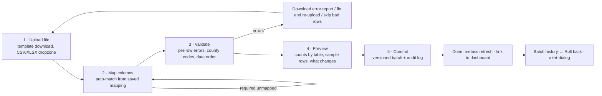
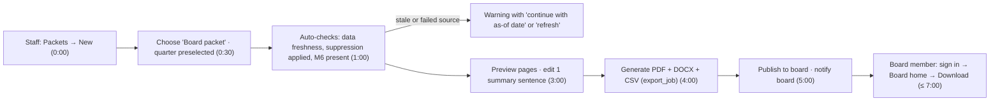
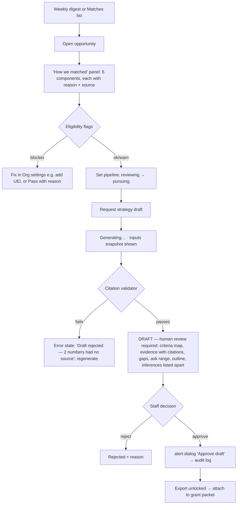

# FAS Evidence Screen Plan & Designs v1

*FAS Evidence, a Family Advocacy Services product ("Public Data to Proof"). Principal product design. Draft, 2026-10-10.*

**Inputs**
- `fas-product-inventory.md` (repo review at `main` b8ea521)
- `design-system-v1.md` (tokens, components, a11y)
- References in `refs/`: Mercury (calm trust), Linear (sidebar shell, dense lists), Clio (label → metric → source hierarchy)

All data in the mockups is synthetic. There are no real people and no real case records.

---

## 0. Design stance

1. **Proof, not decoration.** Every number has three parts: value, the n it's based on, and source + "as of" date. A number with no footer is a bug.
2. **Guardrails are visible states, not silent omissions:**
   - suppressed (n < 11);
   - hidden for complementary suppression;
   - not published;
   - stale;
   - aggregate-only;
   - AI DRAFT.

   Each has a pattern plus a text label. None relies on color alone.
3. **One shell, three depths:**
   - Staff get a working tool, dense like Linear.
   - Board members get a read-only reading room, calm like Mercury, print-first.
   - Admin gets the staff shell plus an Admin group.
4. **Ship in small slices.** The repo has plain CSS, no Tailwind or shadcn, and a 400-line PR cap. Each P0 item below is sized to land as 1–2 PRs:
   - tokens + base;
   - shell;
   - login;
   - 403/errors;
   - trust components.

---

## 1. Information architecture

### 1.1 Roles and landing

| Role | Lands on | Nav groups | Can never see |
|---|---|---|---|
| `staff` | Home (`/home`) | Workspace · FAS data · Grants · Share | Admin group, audit log |
| `admin` | Admin overview (`/admin`), or Home via the switch | Everything staff sees + Admin | — |
| `board_viewer` | Board dashboard (`/board`) | Board (4 items) | Case-level data, uploads, grants, drafts, exact dates, any cell < 11 |

Engineering change needed: `/` must redirect by role, and the new routes must be added to `RULES` in `lib/auth/role-guards.ts`, which denies by default.

### 1.2 Sidebar navigation by role

**staff**
- Workspace
  - Home
  - Team dashboard
  - County need map
  - Data freshness
- FAS data
  - Upload data
  - Cases
  - Aggregate totals
  - Providers
- Grants
  - Matches (count)
  - Pipeline (count)
  - Strategy drafts (count awaiting review)
- Share
  - Packets
  - Methodology

**admin** = staff nav + **Admin**:
- Overview
- Users & roles
- Org settings
- Data sources & ingest runs
- Need-score weights
- Audit log
- Nightly audits

**board_viewer**:
- Board dashboard
- Board packets
- County need map (public data only)
- Methodology

The sidebar footer reads "Read-only access · aggregates only".

**Top bar, all roles:**
- breadcrumbs;
- global freshness chip (e.g. "Public data updated 2 days ago"; text + icon + color);
- environment badge ("Synthetic data" on preview);
- user menu (name, role badge, theme, sign out).

### 1.3 Sitemap

---

## 2. Key flows

### 2.1 Sign in

### 2.2 Upload wizard (F-301)

### 2.3 Board packet in under 10 minutes (PRD §5)

Design budget: no more than 6 clicks for staff and 2 for the board. No step requires typing data.

### 2.4 Grant match → approved strategy draft

---

## 3. Shared patterns (apply to every screen)

### Standard states

| State | Pattern |
|---|---|
| **Empty** | Centered 40px line icon, h4 title, one sentence of why, and one primary action. Role-aware: a board member never sees "Upload". |
| **Loading** | Skeletons that match the final layout. No layout shift. The shimmer is off under reduced-motion. A long job (validation, export, draft) shows a progress line plus a cancel option. |
| **Error** | Inline alert in plain language plus a "Try again" button and a support reference ID. Never show raw Supabase or env text. A failed config shows a "Service unavailable" page. |
| **Permission-denied** | Card naming the area and the user's role, with "Go to your home" and "Ask an admin". Server returns a real 403. The attempt is logged. |

### Trust patterns

- **Suppressed cell:** hatched `--suppressed` fill, with "— n<11" text, a lock glyph, and a tooltip: "Suppressed (n < 11) to protect privacy."
- **Complementary-hidden cell:** same hatch, with "Hidden · protects another cell".
- **Totals:** read "includes hidden bands".
- **Source footer** on every card and table: `Source · period · n · as of <date>`. It opens a provenance sheet (source_id, ingest_run, vintage, last success).
- **Freshness chip:** ✓ Current / ◷ Stale · N days / ✕ Last run failed. Icon, word and color together.
- **Not published:** dashed hatched tile or cell with the words "Not published". The data is never interpolated and never shown as 0.
- **Aggregate badge:** "Σ Aggregate (submitted totals)" wherever aggregate submissions feed a number.
- **DRAFT banner:** "AI draft — human review required" on the screen and on every exported page. Export stays disabled until approval.
- **Dates:** staff case screens may show exact dates. Board views and exports show month or quarter only.
- **Geography:** county level only in shared views.
- **M6:** related-party share is always shown with the affiliated vs. other average rate per hour.

### Accessibility baseline (WCAG 2.2 AA)

- Landmarks plus a skip link.
- Visible 2px focus ring.
- Targets at least 24px (44px for primary actions).
- `th scope` and `aria-sort` on tables.
- Charts have a text summary (`aria-label`) and a "View as table" toggle.
- The map always has a table alternative.
- Text reflows at 320px and 200% zoom.
- Status never relies on color alone.
- The print stylesheet forces the light theme.

---

*Continued in [fas-screen-plan-part2.md](fas-screen-plan-part2.md) (§4–7).*
